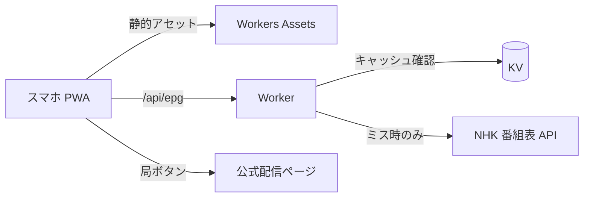

# ポケットTV

公式の同時配信（NHK ONE・TVer）を、番組表つきで1画面から開く個人用テレビ PWA。

## 概要

スマホでテレビを見るとき、局ごとにアプリやサイトを探して開くのは面倒です。ポケットTV は **映像を自前で流さず**、局ごとのボタンから公式の同時配信の視聴ページへ飛ぶだけのランチャーです。NHK総合・Eテレは NHK 番組表 API から「いま」と「次」の番組を取得して表示します。

意図的な設計方針として、チューナー＋B-CAS 方式は扱わず、iframe 埋め込みもせず、TVer の非公式 API も呼びません。映像は必ず公式サービス側で再生されます。個人利用が前提です。

## 主な機能

- 局ごとのボタンをタップして公式配信（NHK ONE・TVer など）の視聴ページを開く
- NHK総合・Eテレの「いま」「次」と番組表の表示（NHK 番組表 API）
- 民放局は番組表なしのリンクのみ
- PWA 対応（ホーム画面に追加できる。`manifest.webmanifest` と `sw.js`）
- API キー未設定でも局ボタンは動作し、番組表だけ「未設定」と表示

## 技術スタック

- Cloudflare Workers（静的アセット配信 + `/api/epg` のみ Worker 処理）
- Cloudflare KV（番組表キャッシュ）
- フロントエンドはビルド不要の素の HTML / CSS / JavaScript
- テストは Node.js 標準の `node --test`（追加依存なし）
- 開発ツールは Wrangler のみ

## アーキテクチャ



- NHK 番組表 API には 1 日 300 回の上限があります。Worker は (サービス, 日付) ごとに KV へ TTL 2 時間で保存し、閲覧者が増えても API 呼び出し回数が増えない作りにしています。
- 取得失敗時は 10 分間 API を叩き直さず、上限超過のエラーに追い打ちをかけません。
- API キーを含む URL が例外メッセージに混ざらないよう、ネットワークエラーの中身は捨てています。
- 外部データ（番組名）は `textContent` で描画し、CSP は `public/_headers` で厳格に設定しています。

## セットアップと起動

前提: Node.js、Cloudflare アカウント、NHK 番組表 API のキー（[NHK API ポータル](https://api-portal.nhk.or.jp)で無料取得）。

```bash
npm install

# ローカル起動: .dev.vars に NHK_API_KEY=... を書いてから
npm run dev

# テスト
npm test
```

デプロイ手順:

1. KV を作成し、出力された id を `wrangler.jsonc` の `kv_namespaces[0].id` に設定する
   `npx wrangler kv namespace create EPG`
2. `wrangler.jsonc` の `account_id` を自分のアカウント ID に置き換える
3. キーを登録する: `npx wrangler secret put NHK_API_KEY`
4. `npm run deploy`
5. スマホで開いて「ホーム画面に追加」

## ディレクトリ構成

```
src/
  worker.js      /api/epg（KV キャッシュ付き NHK 番組表プロキシ）
  epg.js         番組表の正規化・日付処理
public/          静的アセット（index.html, app.js, style.css, sw.js, manifest, _headers）
test/            epg.test.js
wrangler.jsonc   Workers / KV 設定
CLAUDE.md        Claude Code 向けプロジェクト規約
TASKS.md         作業チェックリスト
```

## Claude Code での開発

このリポジトリは Claude Code と、計画 → 実装 → 検証の流れで作りました。

- **計画**: `TASKS.md` に完了の定義とチェックリストを置き、方針決定、公式配信・番組表の仕様調査、設計確定を順に進めた記録が残っています。
- **規約の共有**: `CLAUDE.md` に、扱わない方式（B-CAS 方式、iframe 埋め込み、TVer 非公式 API）、NHK API の利用上限と利用規約上の制約（クレジット表示など）を明文化し、実装時の判断基準にしました。
- **検証**: 番組表の正規化ロジックを `node --test` でテストしています（5 件）。ローカルではスマホ幅の画面でも動作確認しました。
- **未検証の項目**: 実キーでの NHK API Ver.3 レスポンス形の確認と、実機 PWA からの公式アプリ起動確認は未完了です（`TASKS.md` に残課題として記載）。

## ライセンス

未定

NHK番組の情報提供：NHK
